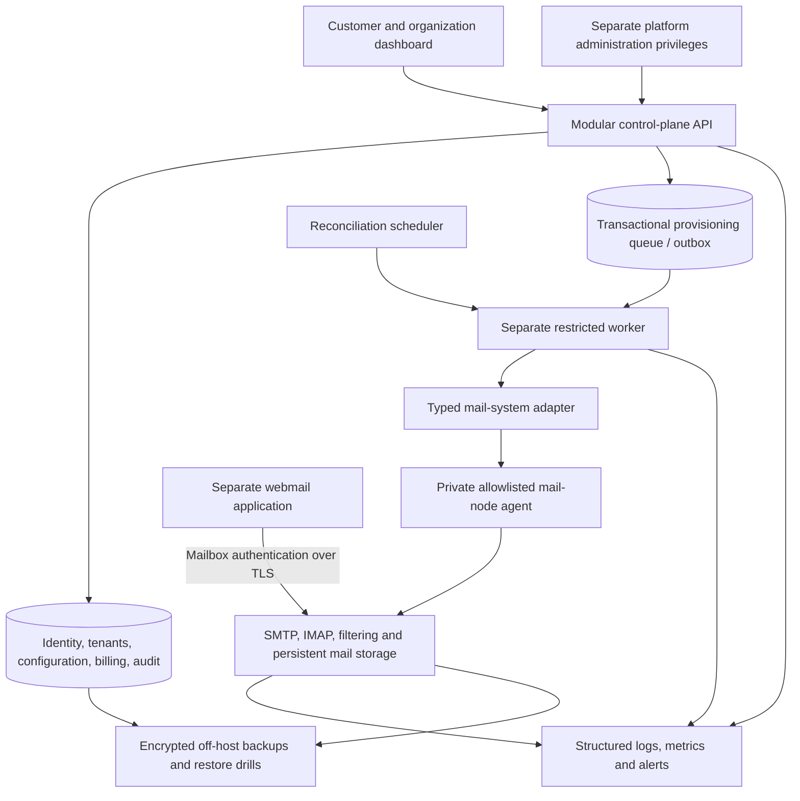
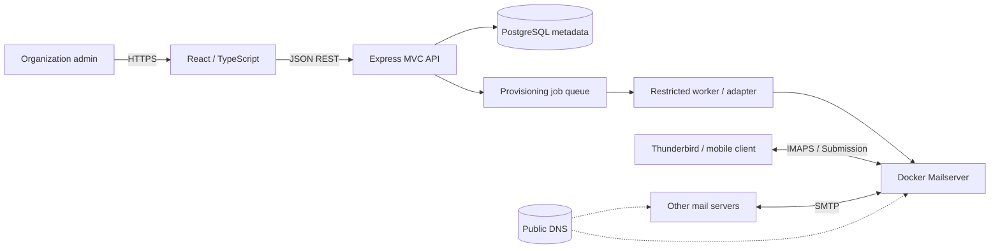

# Nuvomailo architecture

## Latest executable inventory — 14 October 2026

The later implementation supersedes missing-capability entries in the baseline audit below. Persisted rotating/revocable dashboard sessions, expiring reset/verification grant interfaces, encrypted standard TOTP/recovery codes and account status are implemented. Invitations, ownership transfer/leave, organization locking for atomic entitlements, sandbox billing/invoices/immutable checkout quotes, domain health/lifecycle and separate persisted platform roles/recent MFA are implemented. Staff plan catalog and controlled failed-job retry now have UI and authorization tests. Live identity notification/payment providers remain unconfigured.

Webmail now has an explicitly assigned, session-bound server-side boundary and actual synthetic IMAP/SMTP adapter; see [WEBMAIL_FOUNDATION.md](WEBMAIL_FOUNDATION.md). The default application cannot activate it through tenant input. Provisioning still belongs to the separate worker/private agent; normal worker stays pending-only. Real mail credentials, provider activation, commercial billing, aliases/forwarding, independent helper sandbox, coordinated encrypted off-host restore, usage/abuse/fleet operations and full deployment/security acceptance remain unfinished. Current work/results are tracked in [MASTER_IMPLEMENTATION_PROGRESS.md](MASTER_IMPLEMENTATION_PROGRESS.md); the original audit is historical evidence, not current missing-feature status.

**Secure foundation:** see [current policy/agent/credential decisions](SECURE_MAIL_FOUNDATION.md). The lab now separates authentication from SMTP inbound deferral and runs its listener under a dedicated UID; the privileged helper is still lab-only. Production credential grants and provider activation remain unimplemented.

> **M3 local conformance update:** a digest-pinned DMS candidate lab now executes real provider/worker/protocol/recovery scenarios through an authenticated Unix-socket agent. It uses a separate database and closed synthetic mappings; API/default worker remain pending-only. See [actual results and remaining gaps](DMS_CONFORMANCE_RESULTS.md). This is not production provider selection or credential/onboarding approval.

Updated 14 October 2026. Nuvomailo is a long-lived multi-tenant email hosting product. This section supersedes the historical proposal preserved below. Capacity, reliability and commercial readiness must be demonstrated independently of demo dates.

## Repository audit

Inspected backend source/controllers/routes/scripts, all migrations, React source, tests, packages, Compose, documentation and Git changes. Baseline HEAD: `3d36412`; most implementation remains untracked and backend packages/README are modified. PostgreSQL 17 is healthy and loopback-bound. Baseline TypeScript checks, six backend tests and seven frontend tests pass.

| Capability | Actual baseline | Missing evidence / capability |
| --- | --- | --- |
| Identity | Argon2id, 15-minute JWT, profile, rate limits; API tested | MFA, reset, email confirmation, refresh/revocation, disabled accounts, distributed abuse controls |
| Tenants | Membership checks, scoped SQL, protected owner; sequential API tests | Authorization and writes are separate transactions: revocation race. No RLS or runtime DB role separation |
| Domains | IDNA normalization, uniqueness, expiring TXT challenge, renewal/throttle | Tests inject DNS. No live DNS evidence, revalidation/reclamation/transfer or mail-readiness checks |
| Mailboxes | Verified-domain gate, 100/200 MB requested quota, pending job producer | No actual mail state, credential onboarding, usage, retention-aware deprovisioning |
| Provisioning | Mailbox + request commit atomically; API invokes no-op adapter | No worker, retries, leases, dead letters, idempotent execution or reconciliation |
| Dashboard | Real typed API client and required views; jsdom tests | Browser/mail-system e2e, accessibility review, platform admin, webmail |
| Operations | Console logs, liveness, development PostgreSQL Compose | Audit, request correlation, readiness, queue visibility, alerts, backup/restore evidence |
| Commercial product | Planned | Aliases/forwarding/policies, billing, entitlements, abuse operations, mail-node fleet management |

Code existence is not completion. DNS success is simulated; frontend HTTP responses are stubbed; no mail server runs in the Compose stack. No component is certified production-ready.

## Current and target boundaries

Current executable flow: React → Express controllers → services → PostgreSQL repositories. Domain verification independently resolves DNS. Mailbox writes persist provisioning requests but nothing consumes them. PostgreSQL stores configuration, never mail messages. Dashboard identity and mailbox authentication remain separate.



Use one modular TypeScript control plane and a separately runnable worker sharing typed contracts. Introduce a broker, additional services or orchestration only when throughput, trust or release-isolation measurements justify them. API and worker eventually receive different least-privilege DB identities. The API must have no Docker socket, shell execution or mail-node credentials. Platform operator privileges must never be inferred from tenant owner roles.

Modules: identity/access; tenants/members/invitations; domain ownership/readiness; mailbox lifecycle/quotas/credentials; aliases/forwarding/policies; entitlements/billing; audit; platform operations. Only the first four have baseline implementations. Webmail is mailbox-facing and separate from the SaaS administrative UI.

## Provisioning and consistency design

The old adapter contract lacks address/tenant snapshot, revision, cancellation, observation and failure classification. Direct API invocation must be removed before any real implementation is introduced.

- PostgreSQL requests act as queue and transactional outbox: desired state, immutable job snapshot and audit event commit together, avoiding a database/broker dual write.
- Keep desired mailbox state/revision separate from independently observed status/quota/time. HTTP 202 never proves mail operation success.
- Claim due work with row locks and `SKIP LOCKED`; serialize outstanding requests per mailbox. Dead-lettered heads block later operations until reviewed/retried.
- Stable request IDs support adapter idempotency. Lease tokens fence DB acknowledgements; external execution is at least once. Real agents must reject stale revisions and support read-after-timeout; exactly-once effects are not promised.
- Bound attempts, backoff and adapter timeouts; recover expired leases; expose safe failure codes and audited retries. Development deferral must not become active or exhaust attempts.
- Inspect before/after an idempotent full-state ensure operation. Reconciliation queues desired state and records actual drift; it cannot invent success.

Tenant mutations must authorize with a membership row lock and use the same transaction/client for persistence and audit. Revocation then serializes with writes. Network calls stay outside transactions: authorize/claim, perform DNS/mail lookup, then reauthorize/record. Reads admitted before revocation may finish; already committed queued administrative intent remains valid unless explicitly cancelled in a future policy.

Operational/audit views are tenant-scoped, bounded and role-restricted. Structured logs contain generated request IDs and allowlisted metadata, never request bodies, bearer tokens, passwords, TXT values or raw adapter exceptions.

## Mail-system shortlist and production gate

Comparative judgments below are architectural assessments, not benchmarks or a production selection. Verify pinned versions, support/licensing and the same lifecycle/recovery conformance suite before selection.

| Candidate | Fit and tradeoff | Required proof |
| --- | --- | --- |
| Docker Mailserver | File-backed stack with account/alias/quota CLI; suitable contained integration candidate. Nuvomailo still needs a restricted agent and safe credential/state synchronization. | Idempotent create/inspect/quota/suspend, no plaintext argv, concurrency/recovery/multi-node migration. [Official file provisioner](https://docker-mailserver.github.io/docker-mailserver/latest/config/account-management/provisioner/file/) |
| Stalwart | Documents clustering and tenant isolation, but documented multi-tenancy is Enterprise-only. Evaluate edition/commercial terms. | API lifecycle, credentials, licensing, storage recovery and mailbox migration. [Tenants](https://stalw.art/docs/auth/authorization/tenants/), [clustering](https://stalw.art/docs/cluster/) |
| mailcow | Broader integrated administration/webmail-related stack; requires reconciling its administration model with Nuvomailo. Backups must cover mail, configuration and encryption material. | API/auth ownership, resource benchmark, tested consistent restore. [Overview](https://docs.mailcow.email/), [requirements](https://docs.mailcow.email/getstarted/prerequisite-system/), [backup](https://docs.mailcow.email/b_n_r_backup/) |
| Custom Postfix/Dovecot | Maximum control; greater integration, packaging, filtering, upgrade and support responsibility. | Maintainer capability, cost model and tested reference deployment before preference over packaged systems |

Required production inputs: port 25 policy, PTR control, IP reputation, MX/SPF/DKIM/DMARC, independent SMTP/IMAP TLS, spam/malware capacity, outbound abuse policy, storage/IOPS and queue growth, off-host encrypted backups and measured restore time. Benchmark with filtering and realistic attachments enabled. The 1 vCPU/4 GB VPS is only a test environment. Real DNS, VPS changes, live email, spending and deployment need explicit authorization.

## Technical debt and migration risk

| Priority | Finding | Treatment |
| --- | --- | --- |
| P0 | API adapter coupling and no reliable execution engine | Worker boundary, leases/retries/idempotency, independent observations |
| P0 | Revocation/write race; missing audit/logging | Transactional tenant authorization and audit; correlated logs |
| P1 | Legacy jobs have no ordering revision or full snapshot | Deterministic `(created_at,id)` backfill; timestamp ties cannot prove historical order. Preserve all records and unknown observations; review backlog before live enablement |
| P1 | 100/200 MB hard-coded policy | Later versioned plans/entitlements with staged DB/API migration; do not silently widen storage ceilings |
| P1 | Resource ceilings, bounded lists and identity recovery incomplete | Operational pagination now; entitlements, bulk resource pagination and identity recovery are subsequent milestones |
| P1 | Application audit is not tamper-proof | Append-only application interface now; retention, restricted DB grants/export and integrity evidence before production |
| P1 | Database migration locks/backfill and down migrations | Additive development migration; production expand/contract, backup, lock-budget and rollout rehearsal. Do not drop operational history in production |
| P1 | Old docs assert demo scope and outdated interfaces | This architecture, product roadmap and decision log supersede historical phase snapshots |
| P2 | Global pool imports and loose repository result types | Incremental typed models and explicit transactional clients; no ORM rewrite |

Remaining security gates include MFA/recovery/revocation, durable limiting, least-privilege roles, RLS evaluation, browser/XSS/CSRF validation, domain revalidation/reclamation, resource ceilings, credential lifecycle and independent security review.

## This iteration

Audit/design first, then transactional tenant mutation/audit boundaries, additive desired/observed/queue migration, local worker/reconciliation, scoped operational APIs/UI/runbook, and tests/build/migration verification. Track evidence in [PRODUCT_ROADMAP.md](PRODUCT_ROADMAP.md), decisions in [ARCHITECTURE_DECISIONS.md](ARCHITECTURE_DECISIONS.md), results in [VERIFICATION.md](VERIFICATION.md). Real mail/credential topology remains decision-gated.

### Executable state after M1–M2

The baseline table records pre-iteration findings. The current API persists intent/job/audit atomically under tenant membership locks and never calls a mail adapter. `workers/run-provisioning.ts` independently claims due heads, calls actual-inspection/idempotent-ensure interfaces, fences acknowledgements and manages retry/dead letter. The only runtime adapter is pending/deferred. Manual reconciliation and a bounded stale-observation scheduler are implemented. New tenant-admin APIs/UI expose requests and audit history. Request correlation/readiness are implemented; centralized metrics/alerts/backup and production mail remain absent.

Migration `1791977444734_durable-provisioning` adds revisions/observations/leases/audits; `1791977444735_reconciliation-operations` adds explicit reconciliation intent. Local migration tests cover legacy snapshots, no-op rerun and rollback. DNS challenge renewal now preserves the last-attempt timestamp to prevent throttle bypass. See [OPERATIONS.md](OPERATIONS.md) for actual contracts, state transitions and failure recovery.

---

# Historical architecture proposal (superseded)

> **Status:** Proposed · **Version:** 0.1 · **Updated:** 13 October 2026  
> **Decision:** React View + TypeScript/Express MVC + service layer + PostgreSQL + Docker Mailserver  
> **Deployment goal:** Small private pilot, not production school email

## 1. Context and constraints

Nuvomailo is a multi-tenant email hosting control plane: organizations own verified domains and manage their mailboxes. Mail transport and storage are delegated to Docker Mailserver, rather than reimplemented inside the Express API.

**Constraints:**

| Constraint | Design response |
| :--- | :--- |
| Demo target: **18 Oct 2026** | Strict P0 scope and staged deliverables |
| Hostinger KVM 1: **1 vCPU, 4 GB RAM, 50 GB** | One API process; small pilot; resource measurement |
| TypeScript and React are new learning areas | Keep transparent architecture and explicit types |
| Mail is security-sensitive | No public onboarding until isolation and security checks pass |
| Multi-tenant from day one | Scoped queries, memberships, domain ownership proof |
| Possible expansion | Stable internal contracts; defer microservices until necessary |

## 2. Context diagram



### Responsibilities

| Component | Owns | Must **not** own |
| :--- | :--- | :--- |
| **React View** | Forms, navigation, UI state | Authorization decisions, SMTP credentials in source code |
| **Routes / middleware** | Routing, authentication, input validation | Tenant business rules alone |
| **Controllers** | HTTP concerns, status codes, response DTOs | Database transactions, Docker commands |
| **Services** | Tenant policies, domain rules, quotas | `res.json`, direct UI concerns |
| **Repositories** | Parameterized persistence operations | Email delivery |
| **PostgreSQL** | Application metadata and job state | Mail message bodies |
| **Provisioning worker** | Restricted operations on DMS, retry/reconcile | Public HTTP access; broad host privilege |
| **Docker Mailserver** | Postfix/Dovecot, mailbox files, SMTP/IMAP | SaaS tenant authorization for dashboard users |

## 3. Backend structure — MVC with React as View

```text
backend/src/
├── app.ts                  # Compose Express middleware and routes
├── server.ts               # Listen / process lifecycle
├── routes/                 # Resource endpoints
├── controllers/            # HTTP request/response adapters
├── services/               # Business workflows, tenant rules
├── repositories/           # PostgreSQL access
├── models/                 # Domain types / persistence models
├── validators/             # Runtime schema validation (Zod)
├── middlewares/            # Auth, authorization, errors
├── jobs/                   # Provisioning job producer / worker
└── config/                 # Validated configuration
```

Routing is **not** where access control ends: service methods must still receive a verified actor/tenant context and enforce authorization. No `organizationId` from the HTTP body is trusted on its own.

## 4. Core workflows

### 4.1 Create a mailbox

```mermaid
sequenceDiagram
    actor Admin
    participant UI as React
    participant API as Express Controller
    participant S as Mailbox Service
    participant DB as PostgreSQL
    participant W as Restricted Worker
    participant DMS as Docker Mailserver
    Admin->>UI: Create student@school.example (100 MB)
    UI->>API: POST /organizations/:id/mailboxes
    API->>S: Validated command + authenticated actor
    S->>DB: Check membership, verified domain, quota, uniqueness
    S->>DB: Transaction: mailbox PENDING + provisioning job
    DB-->>S: Job ID
    S-->>API: Pending result
    API-->>UI: 202 Accepted (PENDING)
    W->>DB: Claim pending job
    W->>DMS: Restricted account creation + quota
    alt Confirmed success
        W->>DB: Set mailbox ACTIVE; job SUCCEEDED
    else Failure
        W->>DB: Mark retryable FAILED; retain audit trail
    end
```

**Important:** A PostgreSQL transaction cannot atomically commit a change to a separate mail server. Use transactional job creation (or a transactional outbox), idempotency keys, bounded retries and reconciliation. The workflow must never mark a mailbox `ACTIVE` merely because the HTTP request was accepted.

### 4.2 Verify a domain

1. Authenticated organization admin submits a canonicalized domain.
2. Server checks uniqueness and generates a cryptographically random, expiring DNS TXT challenge.
3. UI shows the TXT record the admin must create in their DNS provider.
4. Server resolves DNS **server-side** and compares the TXT value.
5. Verified ownership is recorded before mail provisioning is enabled.
6. SMTP deliverability DNS (MX, SPF, DKIM, DMARC, PTR) is checked **separately**; TXT ownership alone does not establish mail readiness.

Never change an existing institution's MX records without authorization and a migration plan.

## 5. Authentication and tenant boundaries

- A **User** may belong to more than one **Organization** through **Memberships**.
- Minimum pilot roles: `OWNER`, `ADMIN`, `MEMBER` (read-only/limited as explicitly defined).
- Each protected action must resolve and verify membership in the target organization.
- Query restrictions and DB constraints are both needed. Consider PostgreSQL Row Level Security as defense in depth after scoping is correct.
- Domains must be globally unique by canonical name; a mailbox belongs to exactly one verified domain.
- Admin authentication and IMAP/SMTP authentication are **distinct** systems; mailbox passwords are not stored as plaintext in PostgreSQL.

## 6. DNS and protocol boundaries

| Endpoint | Protocol | Notes |
| :--- | :--- | :--- |
| Web / API | HTTPS 443 | Reverse proxy to static React and Express |
| SMTP receive | TCP 25 | Server-to-server inbound; provider access needs verification |
| Mail submission | TCP 587 (STARTTLS) | Authenticated clients |
| IMAPS | TCP 993 | Client mailbox access |

A mail server's TLS certificate and its client-facing mail protocols are configured separately from the API reverse proxy. Never publish the Docker socket, PostgreSQL port, or worker administration on the Internet.

## 7. Resource limits and growth

**Pilot:** 1 vCPU / 4 GB RAM / 50 GB NVMe, intended for small test accounts. This is not a validated capacity for hundreds of active mail users. A 100–200 MB quota is a **ceiling**, not a storage reservation. OS, DB, logs, queues and free space consume disk too.

- Prefer React static build, one TypeScript/Express API process and bounded PostgreSQL connections.
- Mail filtering and antivirus features require resource measurement; disabling a security control has risk and must be documented and compensated.
- Measure CPU, RAM, disk, SMTP queue, delivery failures, IMAP latency and request latency.
- Upgrade/split **mail storage and mail infrastructure** before assuming API-level microservices are the answer.
- After pilot tests, use observed demand to choose between increasing VPS resources or splitting infrastructure.

## 8. Critical risks

| Risk | Response |
| :--- | :--- |
| Cross-tenant data leak | Server-side membership checks + negative tests |
| Host compromise via provisioning | Dedicated restricted worker; no public Docker socket |
| Wrong mailbox state | Async job status + reconciliation |
| Domain hijack | Server-side DNS TXT verification + global uniqueness |
| Mail delivery failure | SPF, DKIM, DMARC, PTR, logs, sender reputation testing |
| Disk exhaustion | Mailbox quotas, monitoring, reserve and backups outside VPS |
| Mailbox data loss | Encrypted off-server backup **and tested restore** |

## 9. Decisions and unresolved questions

- **Accepted:** MVC for Express with React as a separate View; modular monolith first. See [ADR-0001](adr/0001-modular-mvc.md).
- **Proposed:** A dedicated restricted provisioning adapter for DMS `setup` commands. Implementation and security model still require testing.
- **Open:** Mailbox credential onboarding, MFA for dashboard admins, rotation, recovery UX.
- **Open:** Which features of mail filtering are feasible on 1 vCPU / 4 GB RAM without unacceptable risk.
- **Open:** Final production infrastructure and customer onboarding; outside this demo.

## 10. Official technical references

- [Docker Mailserver documentation](https://docker-mailserver.github.io/docker-mailserver/latest/)
- [DMS account management](https://docker-mailserver.github.io/docker-mailserver/latest/config/account-management/overview/)
- [DMS file provisioner / setup CLI](https://docker-mailserver.github.io/docker-mailserver/latest/config/account-management/provisioner/file/)
- [OWASP ASVS](https://owasp.org/www-project-application-security-verification-standard/)
