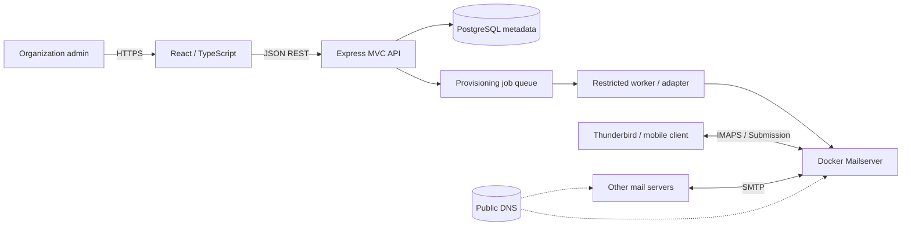

# Architecture · Nuvomailo

> **Status:** Proposed · **Version:** 0.1 · **Updated:** 13 October 2026  
> **Decision:** React View + TypeScript/Express MVC + service layer + PostgreSQL + Docker Mailserver  
> **Deployment goal:** Small private pilot, not production school email

## 1. Context and constraints

Nuvomailo is a multi-tenant email hosting control plane: organizations own verified domains and manage their mailboxes. Mail transport and storage are delegated to Docker Mailserver, rather than reimplemented inside the Express API.

**Constraints:**

| Constraint | Design response |
| :--- | :--- |
| Demo target: **18 Oct 2026** | Strict P0 scope and staged deliverables |
| Hostinger KVM 1: **1 vCPU, 4 GB RAM, 50 GB** | One API process; small pilot; resource measurement |
| TypeScript and React are new learning areas | Keep transparent architecture and explicit types |
| Mail is security-sensitive | No public onboarding until isolation and security checks pass |
| Multi-tenant from day one | Scoped queries, memberships, domain ownership proof |
| Possible expansion | Stable internal contracts; defer microservices until necessary |

## 2. Context diagram



### Responsibilities

| Component | Owns | Must **not** own |
| :--- | :--- | :--- |
| **React View** | Forms, navigation, UI state | Authorization decisions, SMTP credentials in source code |
| **Routes / middleware** | Routing, authentication, input validation | Tenant business rules alone |
| **Controllers** | HTTP concerns, status codes, response DTOs | Database transactions, Docker commands |
| **Services** | Tenant policies, domain rules, quotas | `res.json`, direct UI concerns |
| **Repositories** | Parameterized persistence operations | Email delivery |
| **PostgreSQL** | Application metadata and job state | Mail message bodies |
| **Provisioning worker** | Restricted operations on DMS, retry/reconcile | Public HTTP access; broad host privilege |
| **Docker Mailserver** | Postfix/Dovecot, mailbox files, SMTP/IMAP | SaaS tenant authorization for dashboard users |

## 3. Backend structure — MVC with React as View

```text
backend/src/
├── app.ts                  # Compose Express middleware and routes
├── server.ts               # Listen / process lifecycle
├── routes/                 # Resource endpoints
├── controllers/            # HTTP request/response adapters
├── services/               # Business workflows, tenant rules
├── repositories/           # PostgreSQL access
├── models/                 # Domain types / persistence models
├── validators/             # Runtime schema validation (Zod)
├── middlewares/            # Auth, authorization, errors
├── jobs/                   # Provisioning job producer / worker
└── config/                 # Validated configuration
```

Routing is **not** where access control ends: service methods must still receive a verified actor/tenant context and enforce authorization. No `organizationId` from the HTTP body is trusted on its own.

## 4. Core workflows

### 4.1 Create a mailbox

```mermaid
sequenceDiagram
    actor Admin
    participant UI as React
    participant API as Express Controller
    participant S as Mailbox Service
    participant DB as PostgreSQL
    participant W as Restricted Worker
    participant DMS as Docker Mailserver
    Admin->>UI: Create student@school.example (100 MB)
    UI->>API: POST /organizations/:id/mailboxes
    API->>S: Validated command + authenticated actor
    S->>DB: Check membership, verified domain, quota, uniqueness
    S->>DB: Transaction: mailbox PENDING + provisioning job
    DB-->>S: Job ID
    S-->>API: Pending result
    API-->>UI: 202 Accepted (PENDING)
    W->>DB: Claim pending job
    W->>DMS: Restricted account creation + quota
    alt Confirmed success
        W->>DB: Set mailbox ACTIVE; job SUCCEEDED
    else Failure
        W->>DB: Mark retryable FAILED; retain audit trail
    end
```

**Important:** A PostgreSQL transaction cannot atomically commit a change to a separate mail server. Use transactional job creation (or a transactional outbox), idempotency keys, bounded retries and reconciliation. The workflow must never mark a mailbox `ACTIVE` merely because the HTTP request was accepted.

### 4.2 Verify a domain

1. Authenticated organization admin submits a canonicalized domain.
2. Server checks uniqueness and generates a cryptographically random, expiring DNS TXT challenge.
3. UI shows the TXT record the admin must create in their DNS provider.
4. Server resolves DNS **server-side** and compares the TXT value.
5. Verified ownership is recorded before mail provisioning is enabled.
6. SMTP deliverability DNS (MX, SPF, DKIM, DMARC, PTR) is checked **separately**; TXT ownership alone does not establish mail readiness.

Never change an existing institution's MX records without authorization and a migration plan.

## 5. Authentication and tenant boundaries

- A **User** may belong to more than one **Organization** through **Memberships**.
- Minimum pilot roles: `OWNER`, `ADMIN`, `MEMBER` (read-only/limited as explicitly defined).
- Each protected action must resolve and verify membership in the target organization.
- Query restrictions and DB constraints are both needed. Consider PostgreSQL Row Level Security as defense in depth after scoping is correct.
- Domains must be globally unique by canonical name; a mailbox belongs to exactly one verified domain.
- Admin authentication and IMAP/SMTP authentication are **distinct** systems; mailbox passwords are not stored as plaintext in PostgreSQL.

## 6. DNS and protocol boundaries

| Endpoint | Protocol | Notes |
| :--- | :--- | :--- |
| Web / API | HTTPS 443 | Reverse proxy to static React and Express |
| SMTP receive | TCP 25 | Server-to-server inbound; provider access needs verification |
| Mail submission | TCP 587 (STARTTLS) | Authenticated clients |
| IMAPS | TCP 993 | Client mailbox access |

A mail server's TLS certificate and its client-facing mail protocols are configured separately from the API reverse proxy. Never publish the Docker socket, PostgreSQL port, or worker administration on the Internet.

## 7. Resource limits and growth

**Pilot:** 1 vCPU / 4 GB RAM / 50 GB NVMe, intended for small test accounts. This is not a validated capacity for hundreds of active mail users. A 100–200 MB quota is a **ceiling**, not a storage reservation. OS, DB, logs, queues and free space consume disk too.

- Prefer React static build, one TypeScript/Express API process and bounded PostgreSQL connections.
- Mail filtering and antivirus features require resource measurement; disabling a security control has risk and must be documented and compensated.
- Measure CPU, RAM, disk, SMTP queue, delivery failures, IMAP latency and request latency.
- Upgrade/split **mail storage and mail infrastructure** before assuming API-level microservices are the answer.
- After pilot tests, use observed demand to choose between increasing VPS resources or splitting infrastructure.

## 8. Critical risks

| Risk | Response |
| :--- | :--- |
| Cross-tenant data leak | Server-side membership checks + negative tests |
| Host compromise via provisioning | Dedicated restricted worker; no public Docker socket |
| Wrong mailbox state | Async job status + reconciliation |
| Domain hijack | Server-side DNS TXT verification + global uniqueness |
| Mail delivery failure | SPF, DKIM, DMARC, PTR, logs, sender reputation testing |
| Disk exhaustion | Mailbox quotas, monitoring, reserve and backups outside VPS |
| Mailbox data loss | Encrypted off-server backup **and tested restore** |

## 9. Decisions and unresolved questions

- **Accepted:** MVC for Express with React as a separate View; modular monolith first. See [ADR-0001](adr/0001-modular-mvc.md).
- **Proposed:** A dedicated restricted provisioning adapter for DMS `setup` commands. Implementation and security model still require testing.
- **Open:** Mailbox credential onboarding, MFA for dashboard admins, rotation, recovery UX.
- **Open:** Which features of mail filtering are feasible on 1 vCPU / 4 GB RAM without unacceptable risk.
- **Open:** Final production infrastructure and customer onboarding; outside this demo.

## 10. Official technical references

- [Docker Mailserver documentation](https://docker-mailserver.github.io/docker-mailserver/latest/)
- [DMS account management](https://docker-mailserver.github.io/docker-mailserver/latest/config/account-management/overview/)
- [DMS file provisioner / setup CLI](https://docker-mailserver.github.io/docker-mailserver/latest/config/account-management/provisioner/file/)
- [OWASP ASVS](https://owasp.org/www-project-application-security-verification-standard/)
