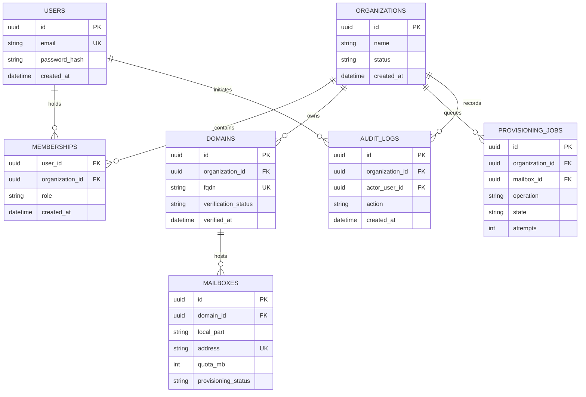

# Data model · Nuvomailo

> **Status:** Proposed schema — **not yet migrated**  
> **Store:** PostgreSQL · **Pattern:** Shared database, tenant-scoped records

## 1. Design objectives

- A user can belong to multiple organizations without duplicating their identity.
- Each domain belongs to one organization after successful ownership verification.
- Each mailbox belongs to one domain; ownership is derived from that domain.
- Mailbox provisioning can fail/retry without inconsistent `ACTIVE` state.
- Metadata is queryable and auditable; **mail messages are stored by Docker Mailserver**, not PostgreSQL.

## 2. Entity relationship diagram



## 3. Tables (proposed)

### `users`

| Column | Type | Rule |
| :--- | :--- | :--- |
| `id` | UUID | Primary key |
| `email` | CITEXT / normalized TEXT | Unique, not null |
| `password_hash` | TEXT | Strong password hash; never plaintext |
| `status` | TEXT | `ACTIVE`, `DISABLED` |
| `created_at`, `updated_at` | TIMESTAMPTZ | Audit timestamps |

This identity is for the **dashboard**, not necessarily a mailbox login.

### `organizations`

`id UUID PK`, `name TEXT NOT NULL`, `status TEXT NOT NULL`, timestamps. Consider `slug` only if a product requirement exists (avoid premature complexity).

### `memberships`

| Column | Type | Rule |
| :--- | :--- | :--- |
| `organization_id` | UUID FK | References `organizations.id` |
| `user_id` | UUID FK | References `users.id` |
| `role` | TEXT | `OWNER`, `ADMIN`, `MEMBER` |
| `created_at` | TIMESTAMPTZ | Not null |

**Constraint:** unique composite `(organization_id, user_id)`; authorization reads this relation on every protected operation. Ownership transfer and preventing the last owner from being removed will require service-level rules and transactions.

### `domains`

| Column | Type | Rule |
| :--- | :--- | :--- |
| `id` | UUID | Primary key |
| `organization_id` | UUID FK | Owning tenant |
| `fqdn` | CITEXT / canonical TEXT | **Globally unique** |
| `verification_status` | TEXT | `PENDING`, `VERIFIED`, `FAILED` |
| `verification_token_hash` | TEXT | Hash of high-entropy challenge where applicable |
| `verification_expires_at` | TIMESTAMPTZ | Avoid stale verification |
| `verified_at` | TIMESTAMPTZ | Null until verified |

Canonicalize domains before insertion, reject domains not owned by the requester, and separate ownership verification from checking actual mail DNS readiness.

### `mailboxes`

| Column | Type | Rule |
| :--- | :--- | :--- |
| `id` | UUID | Primary key |
| `domain_id` | UUID FK | References `domains.id` |
| `local_part` | TEXT | Non-empty, validated |
| `address` | TEXT | Globally unique normalized address |
| `quota_mb` | INTEGER | `CHECK (quota_mb IN (100, 200))` for MVP policy |
| `provisioning_status` | TEXT | `PENDING`, `ACTIVE`, `FAILED`, `DISABLED` |
| `created_at`, `updated_at` | TIMESTAMPTZ | Audit timestamps |

Use service + DB checks so the mailbox address domain matches `domain_id`. Do not create mailbox credentials in plaintext database rows, logs, or job payloads.

### `provisioning_jobs`

`id UUID PK`, `organization_id UUID FK`, `mailbox_id UUID FK`, `operation TEXT`, `state TEXT`, `idempotency_key TEXT UNIQUE`, `attempts INT DEFAULT 0`, `last_error_code TEXT NULL`, `next_attempt_at TIMESTAMPTZ`, timestamps. Restrict job payload fields; do not persist secrets by default.

### `audit_logs`

`id UUID PK`, `organization_id UUID FK`, `actor_user_id UUID FK NULL`, `action TEXT`, `resource_type TEXT`, `resource_id UUID NULL`, `result TEXT`, `created_at TIMESTAMPTZ`. Retention, privacy and redaction policy will be finalized before production.

## 4. Essential constraints and indexes

| Table | Constraint / index | Why |
| :--- | :--- | :--- |
| `users` | `UNIQUE(lower(email))` or `CITEXT UNIQUE` | No duplicate dashboard identity |
| `memberships` | `UNIQUE(organization_id, user_id)` | One membership per organization/user |
| `memberships` | `INDEX(user_id)` | Fast organization lookup |
| `domains` | `UNIQUE(fqdn)` | A domain cannot belong to two tenants |
| `domains` | `INDEX(organization_id)` | Tenant-scoped domain listing |
| `mailboxes` | `UNIQUE(address)` | One global address |
| `mailboxes` | `INDEX(domain_id)` | Domain mailbox listing |
| `provisioning_jobs` | `UNIQUE(idempotency_key)` | Safe retries |
| `provisioning_jobs` | `INDEX(state, next_attempt_at)` | Worker polling |
| `audit_logs` | `INDEX(organization_id, created_at)` | Scoped audit queries |

> [!CAUTION]
> Client-supplied `organization_id` is **not authorization**. Before reading a mailbox via its ID, first verify that the authenticated user belongs to the owning organization with adequate privileges. Use parameterized queries, never string-concatenated SQL.

## 5. Typical tenant-scoped lookup

```sql
-- Conceptual example; not a complete authorization policy.
SELECT m.*
FROM mailboxes AS m
JOIN domains AS d ON d.id = m.domain_id
JOIN memberships AS ms ON ms.organization_id = d.organization_id
WHERE ms.user_id = $1
  AND d.organization_id = $2
  AND m.id = $3;
```

Role checks, account status and explicit permission decisions are still required; this query alone is not a complete access-control implementation.

## 6. Data lifecycle and failure handling

```text
Mailbox requested
   → validate actor, verified domain and quota
   → transaction: mailbox PENDING + provisioning job
   → worker performs restricted DMS action
   → success: ACTIVE / failure: FAILED or retry scheduled
   → reconciliation checks actual mailserver state
```

Never run a mail-server operation "inside" a database transaction and assume rollback will undo it. Build idempotent operations and audit state transitions.

## 7. Open data decisions

- Migration tool: choose after first real DB implementation.
- Should org-local policy allow quotas other than 100/200 MB later?
- Mailbox credential setup, rotation and recovery mechanism (without retaining plaintext).
- How to handle domain transfer, deletion/retention and user privacy.
- Whether to use PostgreSQL Row Level Security as defense in depth.

**Next artifact:** executable migrations and tenant-isolation integration tests; this document alone is not a database schema deployment.
