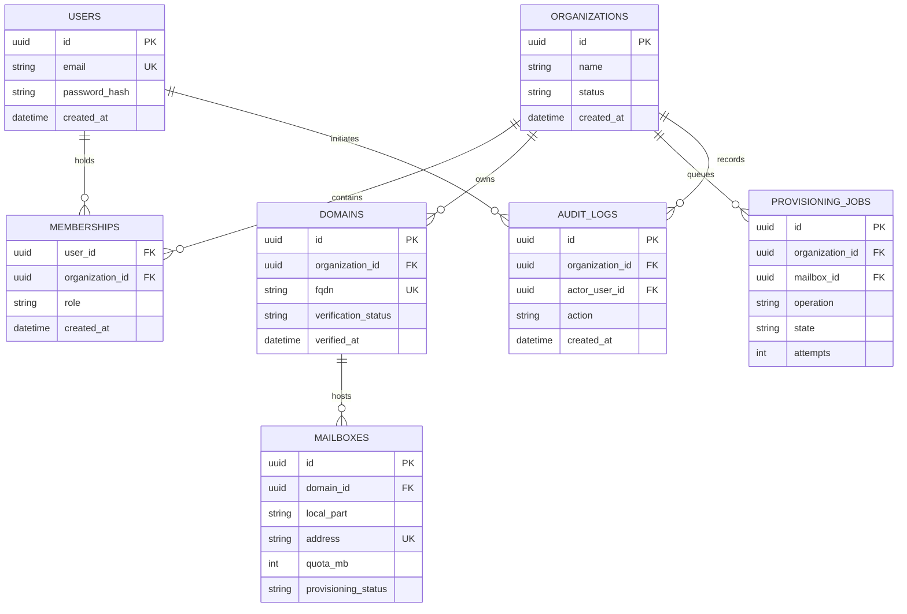

# Current data model · Nuvomailo

Updated 14 October 2026. Executable migrations, not the historical proposal below, are authoritative. PostgreSQL stores control-plane metadata; no mail messages or plaintext mailbox credentials are stored.

Tables: `users`, `organizations`, `memberships`, `domains`, `mailboxes`, `provisioning_requests`, `audit_events`, `identity_sessions`, `refresh_tokens`, `identity_grants`, `security_events`, `membership_invitations`, `mfa_recovery_codes`, `platform_staff`, `platform_events`, `plans`, `organization_subscriptions`, `billing_checkouts`, `billing_webhook_events`, `invoices`, `mailbox_access`, plus `pgmigrations`.

- Baseline migrations `1791977444731`–`1791977444733` implement normalized unique user email, owner/admin/member membership, tenant-owned globally unique domain with TXT proof, and per-domain unique local part with 100/200 MB desired quota.
- `1791977444734_durable-provisioning`: mailbox desired status/revision, applied revision, observed status/quota/time/error; request revision/full-state snapshot, attempt budget, due time, lease token/expiry, safe error and completion time; unique mailbox/revision, due/expiry indexes; tenant/actor/action/resource/metadata audit events and tenant/ID index.
- `1791977444735_reconciliation-operations`: explicit `reconcile` operation in the request constraint.
- `4736_identity-sessions`: account status/version, verification timestamp, revocable sessions, hashed rotating refresh families, purpose/version-bound identity grants and security events.
- `4737_tenant-lifecycle`: active/suspended/retained organizations and expiring email-bound invitations.
- `4738_mfa-platform-staff`: encrypted TOTP enrollment, replay counters, hashed one-use recovery codes, recent session MFA proof, independent staff roles and platform events.
- `4739_billing-entitlements`: sandbox plans/subscriptions/checkouts/webhook digests/invoices and integer quota bounds. `4740_billing-quotes` freezes price/currency per checkout.
- `4741_domain-lifecycle`: retained/suspended configuration, disabled-by-default mail activation; synthetic fixture activation is a separate trusted lab action.
- `4742_mailbox-access`: explicit per-mailbox read/write assignments for verified members. Webmail credentials/sessions remain encrypted ephemeral process memory, not database rows.

Request state is pending/processing/completed/failed; DB checks require a token and expiry exactly when processing. Mailbox desired state is active/suspended; observed state is unknown/absent/active/suspended. `applied_revision <= desired_revision`. Audit IDs are bigint decimal strings in API responses. Each queued state snapshot is immutable across ordinary retries; resetting a failed request preserves ID/revision. Resource/job/audit commit in the same authorization transaction; claim/acknowledgement also use short transactions.

Addresses derive from immutable domain name + local part, rather than duplicated address columns. Domain deletion is restricted while mailboxes exist. Existing queue backfill uses `(created_at,id)` and preserves unknown observations; timestamp ties cannot prove historical order. Production rollout must review backlog, lock/backfill budgets and compatibility with old writers before enabling workers. Down migrations drop added operational history and are only validated in temporary schemas.

See [architecture](ARCHITECTURE.md), [operations](OPERATIONS.md), [verification](VERIFICATION.md) and [current implementation ledger](MASTER_IMPLEMENTATION_PROGRESS.md). Separate runtime DB roles/RLS, production credentials/payment integration, versioned commercial entitlement snapshots, mail-node assignment, message retention/deletion and coordinated backup/PITR remain future work.

---

# Historical data-model proposal (superseded)

> **Status:** Proposed schema — **not yet migrated**  
> **Store:** PostgreSQL · **Pattern:** Shared database, tenant-scoped records

## 1. Design objectives

- A user can belong to multiple organizations without duplicating their identity.
- Each domain belongs to one organization after successful ownership verification.
- Each mailbox belongs to one domain; ownership is derived from that domain.
- Mailbox provisioning can fail/retry without inconsistent `ACTIVE` state.
- Metadata is queryable and auditable; **mail messages are stored by Docker Mailserver**, not PostgreSQL.

## 2. Entity relationship diagram



## 3. Tables (proposed)

### `users`

| Column | Type | Rule |
| :--- | :--- | :--- |
| `id` | UUID | Primary key |
| `email` | CITEXT / normalized TEXT | Unique, not null |
| `password_hash` | TEXT | Strong password hash; never plaintext |
| `status` | TEXT | `ACTIVE`, `DISABLED` |
| `created_at`, `updated_at` | TIMESTAMPTZ | Audit timestamps |

This identity is for the **dashboard**, not necessarily a mailbox login.

### `organizations`

`id UUID PK`, `name TEXT NOT NULL`, `status TEXT NOT NULL`, timestamps. Consider `slug` only if a product requirement exists (avoid premature complexity).

### `memberships`

| Column | Type | Rule |
| :--- | :--- | :--- |
| `organization_id` | UUID FK | References `organizations.id` |
| `user_id` | UUID FK | References `users.id` |
| `role` | TEXT | `OWNER`, `ADMIN`, `MEMBER` |
| `created_at` | TIMESTAMPTZ | Not null |

**Constraint:** unique composite `(organization_id, user_id)`; authorization reads this relation on every protected operation. Ownership transfer and preventing the last owner from being removed will require service-level rules and transactions.

### `domains`

| Column | Type | Rule |
| :--- | :--- | :--- |
| `id` | UUID | Primary key |
| `organization_id` | UUID FK | Owning tenant |
| `fqdn` | CITEXT / canonical TEXT | **Globally unique** |
| `verification_status` | TEXT | `PENDING`, `VERIFIED`, `FAILED` |
| `verification_token_hash` | TEXT | Hash of high-entropy challenge where applicable |
| `verification_expires_at` | TIMESTAMPTZ | Avoid stale verification |
| `verified_at` | TIMESTAMPTZ | Null until verified |

Canonicalize domains before insertion, reject domains not owned by the requester, and separate ownership verification from checking actual mail DNS readiness.

### `mailboxes`

| Column | Type | Rule |
| :--- | :--- | :--- |
| `id` | UUID | Primary key |
| `domain_id` | UUID FK | References `domains.id` |
| `local_part` | TEXT | Non-empty, validated |
| `address` | TEXT | Globally unique normalized address |
| `quota_mb` | INTEGER | `CHECK (quota_mb IN (100, 200))` for MVP policy |
| `provisioning_status` | TEXT | `PENDING`, `ACTIVE`, `FAILED`, `DISABLED` |
| `created_at`, `updated_at` | TIMESTAMPTZ | Audit timestamps |

Use service + DB checks so the mailbox address domain matches `domain_id`. Do not create mailbox credentials in plaintext database rows, logs, or job payloads.

### `provisioning_jobs`

`id UUID PK`, `organization_id UUID FK`, `mailbox_id UUID FK`, `operation TEXT`, `state TEXT`, `idempotency_key TEXT UNIQUE`, `attempts INT DEFAULT 0`, `last_error_code TEXT NULL`, `next_attempt_at TIMESTAMPTZ`, timestamps. Restrict job payload fields; do not persist secrets by default.

### `audit_logs`

`id UUID PK`, `organization_id UUID FK`, `actor_user_id UUID FK NULL`, `action TEXT`, `resource_type TEXT`, `resource_id UUID NULL`, `result TEXT`, `created_at TIMESTAMPTZ`. Retention, privacy and redaction policy will be finalized before production.

## 4. Essential constraints and indexes

| Table | Constraint / index | Why |
| :--- | :--- | :--- |
| `users` | `UNIQUE(lower(email))` or `CITEXT UNIQUE` | No duplicate dashboard identity |
| `memberships` | `UNIQUE(organization_id, user_id)` | One membership per organization/user |
| `memberships` | `INDEX(user_id)` | Fast organization lookup |
| `domains` | `UNIQUE(fqdn)` | A domain cannot belong to two tenants |
| `domains` | `INDEX(organization_id)` | Tenant-scoped domain listing |
| `mailboxes` | `UNIQUE(address)` | One global address |
| `mailboxes` | `INDEX(domain_id)` | Domain mailbox listing |
| `provisioning_jobs` | `UNIQUE(idempotency_key)` | Safe retries |
| `provisioning_jobs` | `INDEX(state, next_attempt_at)` | Worker polling |
| `audit_logs` | `INDEX(organization_id, created_at)` | Scoped audit queries |

> [!CAUTION]
> Client-supplied `organization_id` is **not authorization**. Before reading a mailbox via its ID, first verify that the authenticated user belongs to the owning organization with adequate privileges. Use parameterized queries, never string-concatenated SQL.

## 5. Typical tenant-scoped lookup

```sql
-- Conceptual example; not a complete authorization policy.
SELECT m.*
FROM mailboxes AS m
JOIN domains AS d ON d.id = m.domain_id
JOIN memberships AS ms ON ms.organization_id = d.organization_id
WHERE ms.user_id = $1
  AND d.organization_id = $2
  AND m.id = $3;
```

Role checks, account status and explicit permission decisions are still required; this query alone is not a complete access-control implementation.

## 6. Data lifecycle and failure handling

```text
Mailbox requested
   → validate actor, verified domain and quota
   → transaction: mailbox PENDING + provisioning job
   → worker performs restricted DMS action
   → success: ACTIVE / failure: FAILED or retry scheduled
   → reconciliation checks actual mailserver state
```

Never run a mail-server operation "inside" a database transaction and assume rollback will undo it. Build idempotent operations and audit state transitions.

## 7. Open data decisions

15 October schema continuation: development DB has additive migrations through4751.4749 adds expiring named-staff support grants,4750 a retained mailbox timestamp constrained to suspended desired authentication state,4751 a versioned incident register with unique active component/symptom and resolved timestamp consistency. Runtime API grants include these control-plane tables and read/update of digest-only credential grants for revocation; ordinary worker is denied support/incidents/credential-grant data. Existing mail-lab/recovery snapshot schema remains4744 and the accepted closed image predates4749–4751. Upgrade these explicitly during the next isolated rehearsal.

Migration4752 adds nullable observed usage bytes/message count, observation time and bounded error code to mailboxes plus a leased usage-refresh queue with one outstanding request per mailbox. Null means unknown; stale timestamps remain visible and are never rewritten to zero after an error. Development and the retained isolated mail-lab DB are upgraded through4752. The signed recovery snapshot remains4744 and requires additive migration rehearsal before production use.

Migration4753 adds domain ownership revalidation state, successful-observation/due/attempt timestamps, a bounded failure counter and a 30-day grace deadline. It also adds `released_domain_claims`, which keeps the original domain UUID, organization, actor, reason and SHA-256 name digest without retaining the released plaintext name. The development database is upgraded through4753. The retained closed rehearsal database remains through4752; no image rebuild or volume change was made for this source-level milestone.

Migration4754 adds a monotonic domain revalidation revision, one-outstanding-request scheduling, leases/retries/result state, a verified-owner notification outbox and digest-only synthetic delivery evidence. Migration4755 adds desired and observed mailbox inbound policy plus the immutable policy snapshot on provisioning requests, and the restricted `domain_custody` operation. Development is upgraded through4755. The closed database remains through4752; its existing roles predate `nuvomailo_notification`, and the accepted recovery snapshot predates these queues. Both require an additive upgrade and restore rehearsal before service enablement.

Migration4756 adds personal `webmail_contacts`, uniquely scoped by mailbox, dashboard user and normalized email. Migration4757 adds `webmail_send_attempts`: actor/mailbox/idempotency identity, a SHA-256 request digest, accepted-or-uncertain state, Sent-copy status and recipient counts. It deliberately stores no subject, body, attachment, recipient address or credential. Development is upgraded through4757; the closed database and recovery evidence remain through older schemas and must not be described as including these tables.

Migration4758 adds `platform_heartbeats`, `platform_alert_outbox` and `synthetic_alert_deliveries`. Heartbeats retain only a component, hashed instance identity, fixed state and bounded expiry. Incident alert rows contain fixed component/symptom/severity/state metadata through their incident relation; synthetic delivery retains only the outbox/idempotency IDs and destination digest. Development is upgraded through4758; closed deployment and recovery evidence still predate it.

Migration4759 adds `organization_usage_rollups`. Each organization has at most one current aggregate with mailbox coverage counts, observed byte/message totals, allocated quota and computation time. Runtime grants allow tenant API reads and worker refreshes only. These current aggregates are deliberately non-billable and are not immutable period records. Development is upgraded through4759; closed deployment and recovery evidence still predate it.

Migration4760 adds `billing_renewal_requests` and `synthetic_billing_renewal_effects`, plus a mutually exclusive renewal source on `invoices`. Requests freeze the subscription revision, prior period end, price/currency and entitlement snapshot. States distinguish pending/processing, confirmed success/failure, stale supersession and terminal unknown outcomes. Runtime API access is read-only; the ordinary worker can schedule/process renewal rows and insert invoices but the notification identity has no billing access. Development is upgraded through4760; closed deployment and recovery evidence still predate it.

- Migration tool: choose after first real DB implementation.
- Should org-local policy allow quotas other than 100/200 MB later?
- Mailbox credential setup, rotation and recovery mechanism (without retaining plaintext).
- How to handle domain transfer, deletion/retention and user privacy.
- Whether to use PostgreSQL Row Level Security as defense in depth.

**Next artifact:** executable migrations and tenant-isolation integration tests; this document alone is not a database schema deployment.
