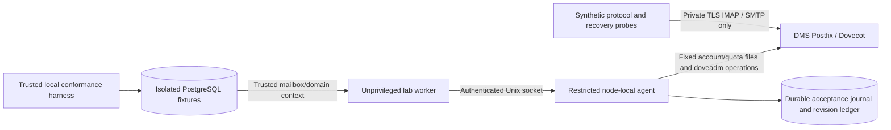

# Docker Mailserver local conformance lab

**Secure-foundation update:** the listener now drops to UID3001 with a separate root lab provider helper; inbound 450 deferral is independent of authentication suspension, and new synthetic accounts use native ARGON2ID. The full runner includes security and restart phases. See [current security architecture](SECURE_MAIL_FOUNDATION.md); historical root-listener/SHA512 creation descriptions below record the original spike.

Date: 14 October 2026. DMS is approved only as the first isolated candidate, not as the final production provider. This lab contains synthetic `.lab.invalid` domains, no real Nuvomailo domain or customer credentials.

## Pinned environment and isolation

DMS **15.1.0**, immutable image digest:

`sha256:af51b15dd3fc72153c0e90eb7692bb5e3a463212d87959a80fa7aa89b617d44a`

Provider source/tag commit: `060bf9a47443382fb7e37f30d6ab9709b4b8aeab`. Runtime: Debian 12, Dovecot 2.3.19.1 and Postfix 3.7.11. Worker Node 24.15.0 image is also digest-pinned. Fixture PostgreSQL uses a separate `postgres:17` container, database and volume; no existing development database credentials or data are used.

Compose project `nuvomailo-dms-lab` has an `internal: true` network, dedicated named volumes and **no host port bindings**. DMS image EXPOSE metadata is not a published port. Postfix default and relay transports explicitly reject non-local delivery. No DNS, VPS, public mail, purchased resources, production credentials or production deployment changed. Filtering/antivirus/reputation components are disabled for this narrow conformance lab; results are not production sizing evidence.

## Architecture implemented



The public API and ordinary worker entry point remain pending-only. `DmsLabAdapter` has mode `local-lab`; `ProvisioningWorker` rejects it unless explicitly constructed with `allowLabAdapter:true`. Only lab entry points opt in, using the separate fixture DB. No customer-facing provider activation flag was added.

Management socket: `/run/nuvomailo-agent/agent.sock`, root-owned directory mode 0750, socket mode 0660, group 3000. Agent checks Linux peer UID **1000**, primary GID **3000**, and a random bearer token from a root/group-readable file. Worker mounts only socket/auth volumes read-only, runs as 1000:3000, has all Linux capabilities dropped and a read-only root filesystem. It has no Docker CLI/socket or access to agent seed/config/mail volumes.

The agent runs as node-local root inside the non-privileged DMS container to update DMS-owned files and run fixed `doveadm` operations. This is a mail-node trust boundary, not a separately sandboxed production privileged helper. No host Docker socket, arbitrary path/container/executable/shell string, command endpoint or TCP management listener exists. Production must still review daemon/agent separation, credentials, runtime grants and remote transport.

`bindings.json` is a read-only, independently trusted synthetic mailbox/node inventory matching fixed fixture identities; the worker derives targets from mailbox/domain SQL joins. The agent rejects tenant/address/mailbox substitution independently. This closed lab inventory is not a production mapping-provisioning design.

## Consistency and runtime observation

Ensure accepts a strict full-state target with stable key and revision. A node-wide file lock serializes shared DMS account/quota file updates (stronger than per-mailbox locking for this file-backed provider). Atomic rename + file/directory fsync persists acceptance before effects. The idempotency journal is authoritative for the maximum accepted revision, even if the convenience ledger update fails. Older revisions and changed payloads under an accepted key/revision are rejected. Repeating an accepted snapshot repairs partial effects and drift rather than returning an unverified cached success.

Actual inspection uses effective `doveadm user` quota fields and an independent Dovecot authentication test with a synthetic credential. File existence alone is not considered actual active state. Missing, inconsistent or not-yet-reloaded runtime state is unknown. The watcher regenerates effective DMS state; ensure waits for convergence and reloads Dovecot for authentication deny rules. Actual quota parsing supports byte values and binary suffixes used by the CLI.

Suspension installs a node-local Dovecot deny passdb **before** the ordinary password passdb, retaining account/hash/mail data, reloads auth and invokes `doveadm kick`. Protocol probes verify new IMAP and SMTP authentication rejection and successful restoration. This is **authentication suspension only**: local inbound SMTP/LMTP delivery continued during suspension. A production policy must separately define receiving restrictions, existing-session handling and rejection vs deferred delivery. Existing SMTP submission sessions were not exhaustively tested.

## Credentials and compatibility findings

No real credentials were provisioned. Lab seed and worker token are generated once in private named volumes, never environment dumps or command arguments. The seed derives synthetic passwords in process memory; only hashes are materialized in account configuration. It is an intentionally lab-only credential generator, not production secret storage. Provisioning requests/results/audit contain no password, hash or credential reference that can reveal a reusable secret.

`doveadm pw` reads synthetic passwords through stdin, with captured output; no `-p` argument is used. SHA512-CRYPT worked for IMAP and SMTP. Dovecot-generated ARGON2ID also worked. A separate operator-only Node probe used the same Argon2id parameters as the SaaS code (64 MiB, time cost 3, parallelism 1), with a fresh synthetic password sent to the probe via stdin, never a real dashboard credential.

**Important compatibility limitation:** the installed Node Argon2 library emits `m,p,t` parameter order. The pinned Dovecot/libsodium rejected that encoded hash unchanged. Reordering only the encoded parameter metadata to canonical `m,t,p` authenticated successfully. Both raw rejection and normalized success were observed; no production hash-import/reset flow or automatic production normalization was introduced. This must be version-pinned, reviewed and tested before selecting a mailbox hash/onboarding scheme. SaaS authentication remains unchanged and separate.

DMS defaults initially logged a truncated SHA1 fingerprint on failed authentication (not plaintext). The lab configure hook disables verbose/debug password logging; verify the effective setting after upgrades/restarts. Mailbox identity logging still occurs. The argv probe found no synthetic password in running process arguments. This snapshot check is not a complete forensic guarantee against every possible leakage path.

## Run, stop and reset safely

From the repository root, after installing backend dependencies:

```powershell
# Full local suite; preserves data and stops its lab services afterward.
powershell -NoProfile -ExecutionPolicy Bypass -File infrastructure/mail-lab/run-conformance.ps1

# Also restore into newly created empty volumes and cold-boot a separate node.
powershell -NoProfile -ExecutionPolicy Bypass -File infrastructure/mail-lab/run-conformance.ps1 -ColdRestore
```

The script builds the backend/image, starts only this lab, checks runtime outcomes, fails immediately on unexpected exit/assertion, and writes credential-free evidence to ignored `infrastructure/mail-lab/results/`. Exit **77** is expected only in the explicit effect-before-worker-exit experiment; a new process must then recover that leased request. Lease expiry is accelerated in the fixture DB instead of waiting two minutes. No result is accepted merely because a command returned zero.

Re-runs preserve synthetic messages/history. The first quota test accepted 12 eight-MiB messages before rejecting the next append; subsequent runs can reject immediately because the preserved mailbox is already near quota. The first partial-effect test created a new account; reruns exercise the same fault point with the retained account. Reports distinguish those contexts.

Manual start/stop:

```powershell
npm --prefix backend run build
docker compose -f infrastructure/mail-lab/compose.yaml build worker
docker compose -f infrastructure/mail-lab/compose.yaml up -d mail db
docker compose -f infrastructure/mail-lab/compose.yaml restart mail
docker compose -f infrastructure/mail-lab/compose.yaml run --rm worker node dist/mail-lab/client.js seed
docker compose -f infrastructure/mail-lab/compose.yaml run --rm worker node dist/mail-lab/client.js tick
docker compose -f infrastructure/mail-lab/compose.yaml stop mail db
```

The host-built `backend/dist` is mounted read-only so source changes require a backend build. The image also contains its own Linux dependencies and compiled sources. Docker Desktop file bind mounts can retain an old file inode after replacement; if a startup hook changed, recreate **only the lab mail container**, retaining named volumes, and verify effective settings. Do not inspect/copy secret volume contents into chat, Git or logs.

**Non-destructive clean reset:** use a fresh Compose namespace (for example `-p nuvomailo-dms-lab-fresh-20261014`) for manual start/seed/test commands. It creates empty isolated volumes and preserves the previous lab. The supplied automated runner intentionally targets its fixed primary project; cold restore uses new timestamped restore projects and fixed primary archive/auth sources.

Deleting old lab volumes or overwriting a restore destination is destructive and was not performed. Before any such reset, obtain explicit approval, stop the exact primary/restore projects, verify their Compose labels and exact volume names, retain needed evidence/backups, then remove only approved lab resources. Never use volume pruning or reset existing project infrastructure. Restore refuses nonempty destination volumes and unsafe archive entries/links.

## Backup/recovery and operational limits

The runner stops Postfix/Dovecot/change detection for a quiescent snapshot. Accounts, quotas, mail, DMS state, TLS material, seed, idempotency journal and revision ledger are archived into a private lab volume. Files are restored and compared in a fresh directory, then `-ColdRestore` extracts into separate empty volumes and boots a new DMS node. The executed cold restore recovered IMAP/SMTP authentication and all 18 messages in that snapshot. Subsequent tests added messages; this does not imply those later messages existed in the earlier archive.

Archives are **local, unencrypted lab artifacts containing sensitive synthetic key/seed/hash material**. No production backup service, off-host encryption, metadata PITR or coordinated SaaS DB/mail restore was implemented. These remain release gates. There is no automatic garbage collection; lab/restore volumes and snapshots are retained.

A point-in-time post-test observation measured mail at approximately 52 MiB and 0.09% CPU (22 processes), fixture PostgreSQL at approximately 22 MiB and 16.59% CPU. Those transient observations are not peak usage, a sustained load benchmark or capacity evidence. DMS was limited to one CPU / 1.5 GiB; spam/malware services were off. Realistic filtering/storage/IOPS/throughput/soak measurements remain necessary.

Docker's initial default stop timeout forced one cleanup exit (137). Primary/restore Compose now specify a 60-second grace period; a subsequent fully started/authenticated primary node stopped cleanly with exit 0 and no OOM kill. Effective password fingerprint logging was also checked as disabled after container recreation/startup. Lab quota numbers use binary MiB; a commercial plan/API must explicitly settle unit semantics instead of assuming decimal MB.

## Candidate assessment and next decision

DMS remains a viable **candidate for further evaluation** based on actual local lifecycle/recovery evidence. It is not selected for production. Significant remaining issues: privileged node-agent scope, one writer for shared files, journal growth/rotation, secure mapping/credentials, mailbox hash compatibility, receive-vs-auth suspension policy, existing SMTP sessions, real filtering capacity, outbound abuse/reputation, public TLS/DNS/ports, off-host encrypted restore/PITR and multi-node migration.

Apply the same criteria to Stalwart/mailcow: independent effective-state API, idempotency and remote revisions, credential compatibility/authentication source of truth, tenant isolation, quota enforcement, suspension/session/receive semantics, alias collisions, upgrades, backup/restore, storage topology, filtering performance, licensing/support and fleet migration. No alternative was benchmarked in this lab.

The next architectural decision is the **production-compatible private management/credential and suspension-policy design**, plus whether to proceed with a hardened DMS prototype or compare alternatives first. Real credentials, public ports/DNS/VPS, external email, paid resources or a privileged Docker-socket boundary remain unapproved.

## Version-pinned primary references

- [DMS v15.1.0 file provisioning documentation](https://github.com/docker-mailserver/docker-mailserver/blob/v15.1.0/docs/content/config/account-management/provisioner/file.md)
- [DMS v15.1.0 account materialization implementation](https://github.com/docker-mailserver/docker-mailserver/blob/v15.1.0/target/scripts/helpers/accounts.sh)
- [DMS v15.1.0 release](https://github.com/docker-mailserver/docker-mailserver/releases/tag/v15.1.0)

The capability matrix and executed outcomes are in [DMS_CONFORMANCE_RESULTS.md](DMS_CONFORMANCE_RESULTS.md).
