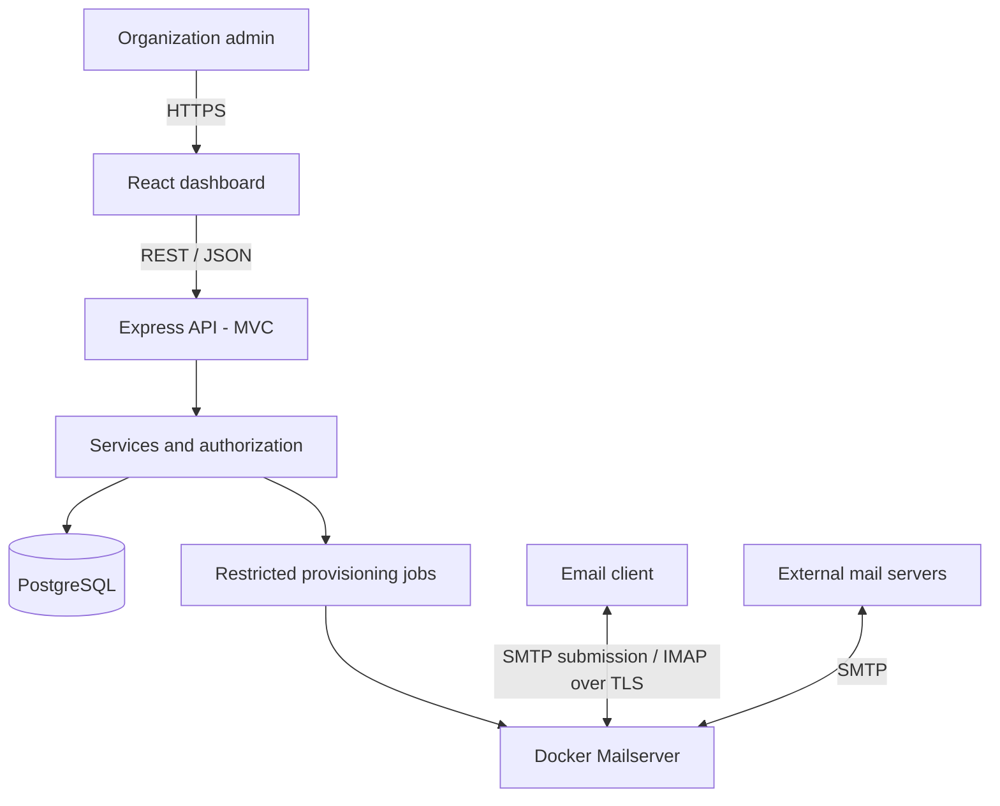

> **Implemented locally: Phases 1–5.** Authentication, tenant permissions, DNS ownership verification, mailbox configuration and the React dashboard are functional. Mail provisioning stays pending; sending/receiving mail, deployment and final infrastructure review remain Phases 6–7. See [local startup and handoff](docs/PHASES_1_5_HANDOFF.md), [implemented API](docs/API_IMPLEMENTED.md), and [verification](docs/VERIFICATION.md). The original planning material below describes the broader target.

<div align="center">

# ✉️ Nuvomailo

### Your mail. Your control.

**An open-source-inspired, multi-tenant email hosting platform.**

[](#project-status)
[](#project-status)
[](#technology-stack)
[](#technology-stack)

**Domain:** `nuvomailo.com` · **MVP demo target:** 18 October 2026

</div>

> [!IMPORTANT]
> **Development project — not yet production-ready.** Do not move real school mailboxes or confidential communications onto this platform before independent security, deliverability, backup/restore and operational validation.

## Overview

Nuvomailo aims to help organizations manage their own domains and professional email accounts through a single dashboard. **Each organization is a tenant** with independently scoped users, roles, domains and mailboxes.

Email is handled by **Docker Mailserver** (SMTP/IMAP); the Nuvomailo application handles administrative workflows, access control and tenant management. These are separate responsibilities.

### Planned MVP

| Area | Scope |
| :--- | :--- |
| **Identity** | Sign in; authenticated management endpoints |
| **Tenancy** | Organizations, memberships and organization-scoped authorization |
| **Domains** | Add domain and verify ownership with a DNS TXT challenge |
| **Mailboxes** | Request mailbox creation and track provisioning status |
| **Quotas** | Configurable pilot quotas: **100 MB / 200 MB** per mailbox |
| **Mail** | SMTP/IMAP connectivity demonstrated with test accounts |
| **Dashboard** | React pages for organizations, domains and mailboxes |
| **Assurance** | Tenant-isolation tests, audit events and basic recovery test |

Planned does **not** mean implemented. The actual state of each requirement is tracked in [Requirements](docs/REQUIREMENTS.md).

## Technology stack

| Layer | Technology | Responsibility |
| :--- | :--- | :--- |
| View | React, TypeScript | Dashboard and UI |
| API / Controllers | Node.js, Express, TypeScript | HTTP endpoints and responses |
| Business logic | Services | Authorization, quotas and domain rules |
| Persistence | PostgreSQL | Organization and provisioning metadata |
| Mail infrastructure | Docker Mailserver | SMTP, IMAP, mailbox storage |
| Containerization | Docker Compose | Local and pilot service orchestration |
| Edge HTTPS | Reverse proxy (planned: Caddy) | Web TLS termination and routing |

**Architectural style:** React as a separate View + Express MVC with a service layer, implemented initially as a **modular monolith**. The mail server remains an independent infrastructure service.

## System at a glance



> [!NOTE]
> The dashboard never connects directly to PostgreSQL, Docker, or the mail server's administrative interface. SMTP/IMAP are separate from HTTP API traffic.

## Repository layout

```text
email_smtp/
├── backend/
│   ├── src/
│   │   ├── config/
│   │   ├── controllers/
│   │   ├── jobs/
│   │   ├── middlewares/
│   │   ├── models/
│   │   ├── repositories/
│   │   ├── routes/
│   │   ├── services/
│   │   ├── validators/
│   │   ├── app.ts
│   │   └── server.ts
│   └── tests/
├── frontend/
│   └── src/
│       ├── components/
│       ├── hooks/
│       ├── pages/
│       ├── services/
│       └── types/
├── infrastructure/
│   ├── docker/
│   └── mailserver/
├── docs/
│   ├── adr/
│   ├── API_CONTRACT.md
│   ├── ARCHITECTURE.md
│   ├── DATABASE.md
│   ├── REQUIREMENTS.md
│   ├── ROADMAP.md
│   └── SECURITY.md
├── .gitignore
└── README.md
```

> The tree describes the intended organization. Empty source directories or files may not yet be functional; there are no "getting started" commands until the corresponding implementation exists.

## Documentation

| Document | Purpose |
| :--- | :--- |
| [Requirements](docs/REQUIREMENTS.md) | MVP scope, acceptance criteria and priorities |
| [Architecture](docs/ARCHITECTURE.md) | Components, boundaries and critical flows |
| [Database](docs/DATABASE.md) | Conceptual data model, keys and constraints |
| [API contract](docs/API_CONTRACT.md) | Proposed endpoints and HTTP semantics |
| [Security](docs/SECURITY.md) | Threats, non-functional controls and test gates |
| [Roadmap](docs/ROADMAP.md) | Delivery milestones through demo day |
| [ADR-0001](docs/adr/0001-modular-mvc.md) | Why we chose MVC + modular monolith |

## Project status

- **Phase:** Phases 1–5 implemented locally; Phases 6–7 pending
- **MVP demo deadline:** **Sunday, 18 October 2026**
- **Pilot environment:** Hostinger KVM 1 — 1 vCPU, 4 GB RAM, 50 GB NVMe
- **Pilot VPS lifetime:** ~2 months of testing **after** the initial build; **not** the development deadline
- **First audience:** Private demonstration for a school; no real school migration in this sprint
- **Pilot mailbox size:** 100 MB default, 200 MB configurable

## Engineering principles

1. **Tenant scope is mandatory:** authorization is enforced server-side on every protected operation.
2. **Untrusted input stays untrusted:** compile-time types complement, but never replace, runtime validation.
3. **Provisioning is asynchronous:** never claim a mailbox is active before the mail server confirms it.
4. **Fail safely:** recoverable jobs, audited actions, restricted secrets and resource caps.
5. **Measure before scaling:** microservices are an option when justified by observed constraints, not a default.

## References

- [Docker Mailserver — official docs](https://docker-mailserver.github.io/docker-mailserver/latest/)
- [Docker Mailserver — account management](https://docker-mailserver.github.io/docker-mailserver/latest/config/account-management/overview/)
- [OWASP ASVS](https://owasp.org/www-project-application-security-verification-standard/)

---

<div align="center"><sub>Built to learn by doing, with security and maintainability as explicit goals.</sub></div>
